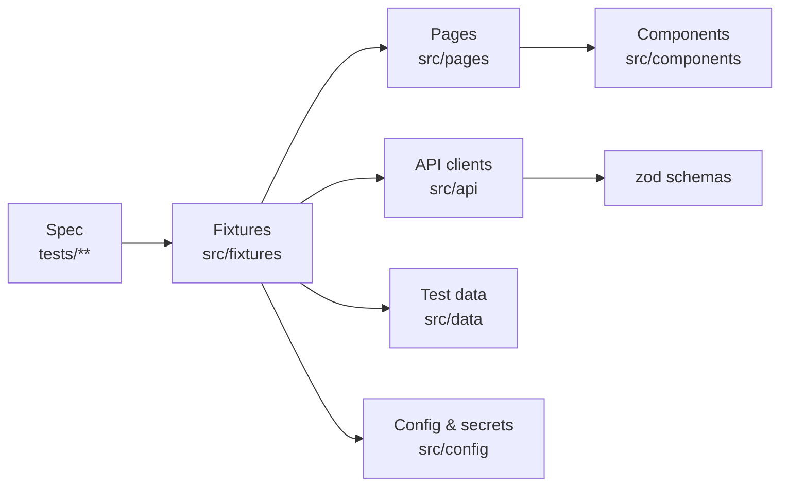

# Playwright TypeScript Framework

[](https://github.com/automatewithalex/playwright-typescript-framework/actions/workflows/pr-checks.yml)
[](https://github.com/automatewithalex/playwright-typescript-framework/actions/workflows/smoke.yml)
[](https://github.com/automatewithalex/playwright-typescript-framework/actions/workflows/regression.yml)

A production-style UI and API test framework built with Playwright and TypeScript. It tests two live
applications from one codebase:

| App                                                      | Project prefix                  | What is covered                                                                               |
| -------------------------------------------------------- | ------------------------------- | --------------------------------------------------------------------------------------------- |
| [automatewithalex.com](https://www.automatewithalex.com) | `awa`                           | marketing site: navigation, contact form, FAQ, resources, contact API                         |
| [testblocks.io](https://testblocks.io)                   | `testblocks`, `testblocks-auth` | SaaS app: pricing, public pages, login, health/billing/auth/projects API, signed-in dashboard |

The suite is deliberately small. Each test exists to show a pattern you would need in a real project.

## What's inside

| Concept                                                                               | Where                                                   |
| ------------------------------------------------------------------------------------- | ------------------------------------------------------- |
| Page Object Model with reusable components                                            | `src/pages`, `src/components`                           |
| Fixtures that inject pages, API clients and test data                                 | `src/fixtures`                                          |
| API layer with zod schema validation                                                  | `src/api`                                               |
| Test data management: static, generated (seeded faker + builders), data-driven tables | `src/data`                                              |
| Validated environment config, secrets from env only                                   | `src/config`                                            |
| Authentication: API login once, stored session reused by every signed-in test         | `tests/testblocks/auth.setup.ts`, `src/support/auth.ts` |
| Self-cleaning test data (create in fixture, delete in teardown)                       | `tempProject` in `src/fixtures/testblocks.ts`           |
| Network mocking and blocking analytics                                                | `src/mocks`, `src/fixtures/base.ts`                     |
| Tags: `@smoke @regression @ui @api @mobile @visual @a11y @auth`                       | `src/support/tags.ts`                                   |
| Cross-browser and mobile projects                                                     | `playwright.config.ts`                                  |
| Visual regression with CI-owned baselines                                             | `tests/**/visual`                                       |
| Accessibility (axe, WCAG 2.1 AA) with a known-issues baseline                         | `src/support/accessibility.ts`                          |
| Retries, traces, videos, flaky test reporting                                         | `playwright.config.ts`, `scripts/ci-summary.mjs`        |
| CI: PR checks, daily smoke, sharded nightly regression, on-demand runs                | `.github/workflows`                                     |
| AI-assisted maintenance: Claude Code skills and Playwright healer agent               | `CLAUDE.md`, `.claude`                                  |

## Quick start

```bash
nvm use                      # Node 22+
npm ci
npx playwright install --with-deps
cp .env.example .env         # optional: TestBlocks test account for signed-in tests

npm test                     # everything
npm run test:smoke           # @smoke only
npx playwright test --project=awa:chromium
npx playwright test --grep "@api|@a11y"
npm run test:ui              # Playwright UI mode
npm run report               # last HTML report
```

Without `TB_TEST_EMAIL` and `TB_TEST_PASSWORD`, signed-in tests are skipped with a reason, not failed.

## Architecture



- **Specs** describe behaviour only. They contain no locators, URLs or literal test data.
- **Fixtures** are the single entry point; a test asks for `homePage`, `contactApi` or `tempProject` and receives it ready to use.
- **Pages** have a URL and are composed of **components** (navigation, forms, pricing table). Neither asserts.
- **API clients** parse every response with a schema, so a contract change fails with a clear message.

```
src/
  api/          ApiClient base + per-app clients
  components/   reusable parts of pages
  config/       environments + validated env loader
  data/         static/ builders/ cases/ models/ + seeded faker
  fixtures/     base (auto fixtures), per-app fixtures, API context factory
  mocks/        network route mocks
  pages/        page objects
  support/      tags, auth session, accessibility audit
tests/
  automate-with-alex/  ui/ api/ a11y/ visual/
  testblocks/          ui/ api/ a11y/ visual/ authenticated/ auth.setup.ts
```

## Writing a test

```ts
import { test, expect } from '@fixtures/automate-with-alex';
import { aContactMessage } from '@data/builders/ContactMessageBuilder';
import { mockContactApi } from '@mocks/contact-api';
import { Tag } from '@support/tags';

test(
  'sends the filled-in requirements and confirms',
  { tag: [Tag.ui, Tag.smoke] },
  async ({ homePage, page }) => {
    const sent = await mockContactApi(page);
    const message = aContactMessage().forService('project-delivery').build();

    await homePage.contactForm.send(message);

    await expect(homePage.contactForm.successMessage).toBeVisible();
    expect(sent).toEqual([expect.objectContaining({ email: message.email })]);
  },
);
```

## Test data

| Kind                  | Example                                        | Rule                                                            |
| --------------------- | ---------------------------------------------- | --------------------------------------------------------------- |
| Static reference data | plan prices, navigation labels                 | `src/data/static`, one place to update when the product changes |
| Generated data        | `aContactMessage().withInvalidEmail().build()` | builders on a seeded faker                                      |
| Data-driven cases     | contact API validation table                   | `src/data/cases`, looped in the spec                            |
| Server-side data      | TestBlocks projects                            | created by a fixture with a unique name, deleted in teardown    |
| Secrets               | TestBlocks credentials                         | env variables only                                              |

Every test records its faker seed as an annotation. To replay a failing run with the same data:
`FAKER_SEED=<seed> npx playwright test <file>`.

## Secrets and authentication

- Locally: `.env` (git-ignored). In CI: secrets of the GitHub environment `production`
  (`TB_TEST_EMAIL`, `TB_TEST_PASSWORD`), masked in logs.
- `testblocks-auth:setup` logs in once through the API and writes the session to `.auth/` (git-ignored).
  `testblocks-auth:chromium` tests start already signed in; the UI login itself is covered by one test in
  `tests/testblocks/ui/login.spec.ts`.
- Negative login tests use an account that does not exist, so they can never lock the real one.

## CI/CD

All pipelines call one reusable workflow, `_run-tests.yml`. It runs inside the official Playwright
container, merges sharded blob reports into one HTML + JUnit + JSON report, uploads it as an artifact
and writes a summary of failed and flaky tests to the job page.

| Workflow   | Trigger                         | Runs                                                                         |
| ---------- | ------------------------------- | ---------------------------------------------------------------------------- |
| PR checks  | pull request                    | typecheck, lint, format, then `@smoke` on Chromium                           |
| Smoke      | push to `main`, daily 06:00 UTC | `@smoke` on every project                                                    |
| Regression | nightly 02:00 UTC, manual       | full suite, 2 shards                                                         |
| On demand  | manual                          | any tag expression × app × browser × shards; can regenerate visual baselines |

On demand from the CLI:

```bash
gh workflow run on-demand.yml -f grep="@api" -f app=testblocks -f browser=chromium
gh workflow run on-demand.yml -f update-snapshots=true
```

Reports: open the run, download `playwright-report-<attempt>`, then `npx playwright show-report playwright-report`.

## Stability

- **Retries:** 2 in CI, 0 locally. The first retry records a trace; failures keep a video and a screenshot.
- **Flaky tests:** tests that pass only on retry are listed in the job summary.
- **Healing:** run the `heal-failing-test` skill or the Playwright healer agent. It proposes a fix (usually
  a locator in a page object), and you review it as a normal commit. There is no silent runtime
  self-healing, because that would hide real regressions.
- **Known product bugs** stay covered with `test.fail(true, 'Known bug: ...')`. When the bug is fixed,
  Playwright reports the test as unexpectedly passing and the marker is removed.
- **Visual baselines** are generated only in CI (`update-snapshots`), so fonts and rendering always match.
- **Accessibility:** known violations live in `src/data/static/accessibility-baseline.ts`; any new rule
  violation fails the test.

## Working with Claude Code

`CLAUDE.md` holds the project rules. `.claude/skills` has step-by-step skills (`write-test`,
`add-page-object`, `heal-failing-test`, `review-test`), and `.claude/agents` has the official Playwright
planner, generator and healer agents (`npx playwright init-agents --loop=claude`).

## Conventions

- Branches: `feat/`, `test/`, `fix/`, `ci/`, `docs/`, `chore/`; every change lands through a pull request.
- Commits follow [Conventional Commits](https://www.conventionalcommits.org).
- `npm run check` must pass before pushing.
